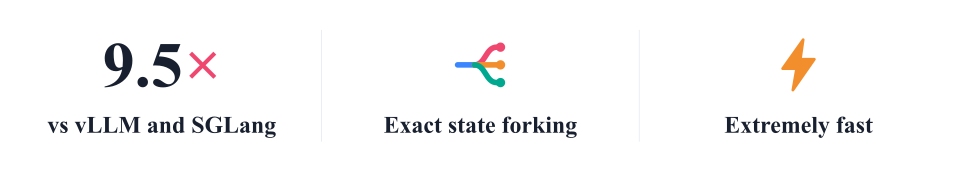
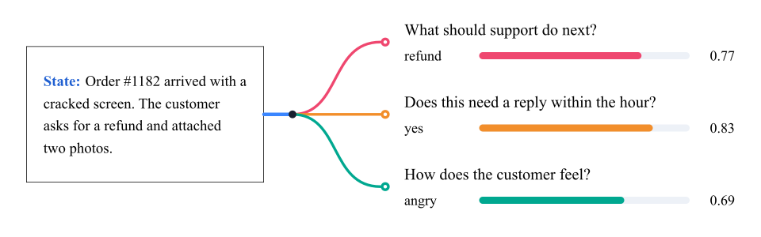
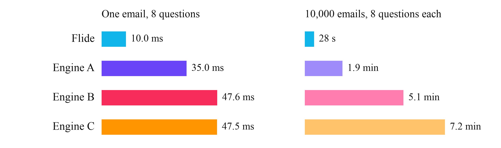

<p align="center">
  
</p>

<p align="center"><b>English</b> · <a href="assets/README_zh.md">简体中文</a> · <a href="assets/README_ja.md">日本語</a> · <a href="assets/README_ko.md">한국어</a></p>

<p align="center">
  <a href="https://arxiv.org/abs/2610.42148"></a>
  <a href="https://pypi.org/project/flide/"></a>
  <a href="https://flide.org"></a>
  <a href="https://docs.flide.org"></a>
  <a href="LICENSE"></a>
  <a href="https://www.python.org"></a>
  <a href="https://pytorch.org"></a>
</p>

<p align="center"><a href="#-news">News</a> · <a href="#quick-start">Quick start</a> · <a href="#models">Models</a> · <a href="#options">Options</a></p>

[Flide](https://docs.flide.org) is fast inference infrastructure for Jev-style decision models. With exact state forking it is up to 9.5 times faster than vLLM and SGLang, and every answer is the one the model gives the question alone. It serves the Jev `/v1/systemone` API.

<p align="center">
  
</p>

<p align="center">
  
</p>


## 🔥 News

- 🔥 **2026-11-11** We added [FlexDM-LoRA-v2.1](https://huggingface.co/1000luca/FlexDM-LoRA-v2.1), [Sieve-31B-v3](https://huggingface.co/sthanika-ai/Sieve-31B-v3) and [JDI-Decision-V1](https://huggingface.co/JoyIndustrial/JDI-Decision-V1) in Flide 0.1.13, and precompiled kernels for RTX 40 series GPUs.
- 🔥 **2026-11-10** We added [GLiDE](https://huggingface.co/collections/fastino/glide-6ada5467fb7eb6ac014fcc4b), [Nimble-v4-max](https://huggingface.co/bespokelabs/Nimble-v4-max) and [clef-flash](https://huggingface.co/Cloudflare/clef-flash) in Flide 0.1.12, and precompiled kernels for RTX 50 series and RTX PRO 6000 GPUs.
- 🔥 **2026-11-10** We added an [email triage demo](https://github.com/OmniJev/Flide/tree/main/demos/email_triage) in Flide 0.1.11, where Flide tags 10,000 emails with eight questions each in 28 seconds on one H200.

<details><summary>Earlier news</summary>

- 🔥 **2026-11-09** We added [Ainvest-Decision](https://huggingface.co/Ainvest-World/Ainvest-Decision-27b-v1.0), [Darwin-27B-RSI-Decision](https://huggingface.co/FINAL-Bench/Darwin-27B-RSI-Decision) and [KnowLine-31B-Gen1.5](https://huggingface.co/PelaAI/KnowLine-31B-Gen1.5) in Flide 0.1.10, and the KnowLine family now reads images.
- 🔥 **2026-11-09** We added [pplx-decider-v1.1-27b](https://huggingface.co/perplexity-ai/pplx-decider-v1.1-27b) and [JEV-35B](https://huggingface.co/autotrust/JEV-35B) in Flide 0.1.9, and `/v1/systemone` now takes several requests in one body.
- 🔥 **2026-11-08** We added two decision model families in Flide 0.1.8, including [AutoTrust](https://huggingface.co/collections/autotrust/autotrust-decision-models-6ada7050d1462de6733b7f98) and [Clef](https://huggingface.co/collections/Cloudflare/clef-6ac429cac15d70ee2af5d1c6), and also [drex-max-v1](https://huggingface.co/nace-ai/drex-max-v1).
- 🔥 **2026-11-02** We released our paper [Flide: Accelerating Decision Inference with Exact State Forking](https://arxiv.org/abs/2610.42148) on arXiv.
- 🔥 **2026-10-29** We added three decision model families in Flide 0.1.7, including [SynACK Decide](https://huggingface.co/SkyPanther/synack-decide-26b-a4b), [Wald](https://huggingface.co/collections/org2ai/wald) and [Xor](https://huggingface.co/juspay/Xor-26B-A4B), and Gemma 4 mixture-of-experts models such as [KnowLine-26B-A4B](https://huggingface.co/PelaAI/KnowLine-26B-A4B-Gen2.5).
- 🔥 **2026-10-29** We added two decision model families in Flide 0.1.6, including [Drex](https://huggingface.co/nace-ai/drex-v2.0) and [KnowLine](https://huggingface.co/PelaAI/KnowLine-35B-A3B-Gen1.5), and `flide verify` checks exact forking on your own model and requests.
- 🔥 **2026-10-28** We added six decision model families in Flide 0.1.5, including [Jeffan](https://huggingface.co/collections/tattrongvu/decision-model-6ad5c85a79bd246cc1c18c4a), [JevAny](https://huggingface.co/collections/SimpleJev/jevany-adaptive-decision-systems-6abc8fd39266b1c17b11b4e6), [Kev](https://huggingface.co/collections/jaredpalmer/kev-6aad9d0ea49f2589665e07cd), [Lychee](https://huggingface.co/LycheeAI/Lychee-27B), [pplx-decider](https://huggingface.co/perplexity-ai/pplx-decider-flash-v1.2) and [StartLux](https://huggingface.co/collections/startlux-models/startlux-decision-v11-instant-6aca8158623e8e001724cc82), and images for [Lumma](https://huggingface.co/collections/FrontiersMind/lumma-decision-models-6ab6356434b3db6856ec7ae6) and [mammoth](https://huggingface.co/baselabs/mammoth-1).
- 🔥 **2026-10-26** We added five decision model families in Flide 0.1.4, including [cerno](https://huggingface.co/apertixai/cerno-27b), [JADE](https://huggingface.co/theunnecessarythings/JADE), [Linne](https://huggingface.co/collections/PNPM244/decision-model-6ad363fb3351cecf1112a5a8), [mammoth](https://huggingface.co/baselabs/mammoth-1) and [Sieve](https://huggingface.co/collections/sthanika-ai/sieve-6abb93a61dd495f69811c586), and also [Quyet-1.0-Large](https://huggingface.co/chinhnc/Quyet-1.0-Large).
- 🔥 **2026-10-26** We added eight decision model families in Flide 0.1.3, including [AJev](https://huggingface.co/andyzhang232/ajev-gemma4-12b-lora7), [Bespoke-Nimble](https://huggingface.co/bespokelabs/Bespoke-Nimble-9B-v3), [Darwin](https://huggingface.co/collections/FINAL-Bench/ztc-models-jev-ecosystems-6aafa630afd69b39ead55aa8), [jiwo](https://huggingface.co/eljiwo/jiwo-4b), [Lumma](https://huggingface.co/collections/FrontiersMind/lumma-decision-models-6ab6356434b3db6856ec7ae6), [mogan](https://huggingface.co/moganai/mogan-decision-31B-it), [Quyet](https://huggingface.co/collections/chinhnc/quyet-10-6ac1b597a9a6a6806bb01fa6) and [Senova](https://huggingface.co/WangSenQWQ/Senova-4B), and LoRA adapters now serve as they are.
- 🔥 **2026-10-25** We added two decision model families in Flide 0.1.2, including [Intern-Decision](https://huggingface.co/collections/internlm/intern-decision-6ab75776af19ca84df0bc004) and [torchcast](https://huggingface.co/torchcast-ai/torchcast-decision-27b), and a question now takes up to 256 options.
- 🔥 **2026-10-24** We released Flide 0.1.0 on [PyPI](https://pypi.org/project/flide/), serving [Qwen3.5](https://huggingface.co/collections/Qwen/qwen35-6992e3053c019221cf2d725f) and [Gemma 4](https://huggingface.co/collections/google/gemma-4-69ce8ad93186d46744cb42f1) chat models and the [OneJev](https://huggingface.co/collections/OmniJev/onejev16-6ad27669cb868abe0516486d) and [Open-Jev](https://huggingface.co/collections/ZefanCai/open-jev-6ab049b9d43a267bae4dedc8) decision models. Welcome to have a try.

</details>

## Quick start

See the [docs](https://docs.flide.org) for every model, images, the API and all options.

```bash
uv venv -p 3.12 && source .venv/bin/activate
uv pip install flide torchvision
flide serve --model OmniJev/OneJev1.6-0.8B
```

Any model in the [model table](#models) starts the same way, for example Perplexity's decision model.

```bash
flide serve --model perplexity-ai/pplx-decider-flash-v1.2
```

Every one of them answers this request.

```bash
curl http://localhost:8000/v1/systemone -H "Content-Type: application/json" -d '{
  "state": "Order #1182 arrived with a cracked screen. The customer asks for a refund and attached two photos.",
  "questions": {
    "action": {"type": "choice", "instructions": "What should support do next?",
               "criteria": {"refund": "refund the order", "replace": "send a replacement", "escalate": "ask a human"}},
    "urgent": {"type": "noul", "instructions": "Does this need a reply within the hour?"}
  }
}'
```

## Example

Flide answers eight questions for each of 10,000 emails in only 28 s. The [email triage demo](https://github.com/OmniJev/Flide/tree/main/demos/email_triage) has the code to run it yourself.

<p align="center">
  
</p>

<p align="center">
  
</p>

On one H200 with OneJev1.6-0.8B, Flide answers one email in 10.0 ms and all 10,000 in 28 seconds, 3.5 times as fast as the fastest other engine for one email and 4.1 times for all of them.

## Models

The last three columns say how much faster Flide answers one request than the engine its release ships, as the median latency over the requests of each workload on one H200, where DI is the Decision Index. The chat models run against the faster of vLLM and SGLang, and OneJev against qev, the engine it used before Flide. KnowLine 35B runs with `--quantize fp8`, as its release serves it in FP8. A value marked ~ is the average over the sizes tested.

| Model | Inputs | DI | MultiRC | QuALITY |
|---|---|---:|---:|---:|
| [Ainvest-Decision](https://huggingface.co/Ainvest-World/Ainvest-Decision-27b-v1.0) | text | 1.4× | 1.3× | 1.3× |
| [AJev](https://huggingface.co/andyzhang232/ajev-gemma4-12b-lora7) | text | 3.7× | 9.3× | 2.6× |
| [AutoTrust](https://huggingface.co/collections/autotrust/autotrust-decision-models-6ada7050d1462de6733b7f98) | text, images | ~3.2× | ~7.6× | ~1.6× |
| [Bespoke-Nimble](https://huggingface.co/bespokelabs/Nimble-v4-max) | text | ~2.1× | ~1.8× | ~1.5× |
| [cerno](https://huggingface.co/apertixai/cerno-27b) | text | ~4.1× | ~8.6× | 1.1× |
| [Clef](https://huggingface.co/collections/Cloudflare/clef-6ac429cac15d70ee2af5d1c6) | text, images | ~1.7× | ~1.1× | ~1.0× |
| [Darwin](https://huggingface.co/collections/FINAL-Bench/ztc-models-jev-ecosystems-6aafa630afd69b39ead55aa8) | text | ~1.4× | ~4.2× | ~1.2× |
| [Drex](https://huggingface.co/nace-ai/drex-v2.0) | text, images | ~2.8× | ~6.2× | ~1.5× |
| [FlexDM](https://huggingface.co/1000luca/FlexDM-LoRA-v2.1) | text | 1.1× | 2.0× | 2.8× |
| [Gemma 4](https://huggingface.co/collections/google/gemma-4-69ce8ad93186d46744cb42f1) | text, images | ~1.3× | ~1.7× | ~1.0× |
| [GLiDE](https://huggingface.co/collections/fastino/glide-6ada5467fb7eb6ac014fcc4b) | text | ~6.4× | ~1.9× | ~1.8× |
| [Intern-Decision](https://huggingface.co/collections/internlm/intern-decision-6ab75776af19ca84df0bc004) | text, images | 4.4× | 1.1× | 1.5× |
| [JADE](https://huggingface.co/theunnecessarythings/JADE) | text | 2.0× | 9.2× | 1.7× |
| [JDI-Decision](https://huggingface.co/JoyIndustrial/JDI-Decision-V1) | text, images | 1.3× | 2.8× | 1.3× |
| [Jeffan](https://huggingface.co/collections/tattrongvu/decision-model-6ad5c85a79bd246cc1c18c4a) | text | 3.1× | 2.6× | 1.9× |
| [JevAny](https://huggingface.co/collections/SimpleJev/jevany-adaptive-decision-systems-6abc8fd39266b1c17b11b4e6) | text, images | 1.5× | 5.8× | 1.2× |
| [jiwo](https://huggingface.co/eljiwo/jiwo-4b) | text | ~1.9× | ~5.9× | 1.8× |
| [Kev](https://huggingface.co/collections/jaredpalmer/kev-6aad9d0ea49f2589665e07cd) | text | ~7.9× | ~1.5× | ~1.7× |
| [KnowLine](https://huggingface.co/PelaAI/KnowLine-35B-A3B-Gen1.5) | text, images | ~1.4× | ~4.3× | ~1.5× |
| [Linne](https://huggingface.co/collections/PNPM244/decision-model-6ad363fb3351cecf1112a5a8) | text | 2.3× | 8.6× | 1.2× |
| [Lumma](https://huggingface.co/collections/FrontiersMind/lumma-decision-models-6ab6356434b3db6856ec7ae6) | text, images | 1.7× | 7.1× | 1.2× |
| [Lychee](https://huggingface.co/LycheeAI/Lychee-27B) | text | 1.4× | 1.5× | 1.4× |
| [mammoth](https://huggingface.co/baselabs/mammoth-1) | text, images | ~4.3× | ~2.8× | ~1.8× |
| [mogan](https://huggingface.co/moganai/mogan-decision-31B-it) | text | 1.6× | 8.5× | 1.8× |
| [OneJev](https://huggingface.co/collections/OmniJev/onejev16-6ad27669cb868abe0516486d) | text, images, video | ~6.8× | 7.3× | 4.7× |
| [Open-Jev](https://huggingface.co/collections/ZefanCai/open-jev-6ab049b9d43a267bae4dedc8) | text | 4.2× | 5.0× | ~1.5× |
| [pplx-decider](https://huggingface.co/perplexity-ai/pplx-decider-flash-v1.2) | text, images | ~2.2× | ~1.4× | ~1.3× |
| [Quyet](https://huggingface.co/collections/chinhnc/quyet-10-6ac1b597a9a6a6806bb01fa6) | text | ~3.9× | ~7.1× | ~1.6× |
| [Qwen3.5](https://huggingface.co/collections/Qwen/qwen35-6992e3053c019221cf2d725f) | text, images | ~2.1× | ~4.8× | ~1.3× |
| [Senova](https://huggingface.co/WangSenQWQ/Senova-4B) | text | 3.1× | 28.1× | 1.2× |
| [Sieve](https://huggingface.co/collections/sthanika-ai/sieve-6abb93a61dd495f69811c586) | text | ~2.3× | ~8.1× | ~2.3× |
| [StartLux](https://huggingface.co/collections/startlux-models/startlux-decision-v11-instant-6aca8158623e8e001724cc82) | text | 2.6× | 1.1× | 1.2× |
| [SynACK Decide](https://huggingface.co/SkyPanther/synack-decide-26b-a4b) | text | 3.3× | 11.9× | 3.0× |
| [torchcast](https://huggingface.co/torchcast-ai/torchcast-decision-27b) | text, images | 1.6× | 8.4× | 1.4× |
| [Wald](https://huggingface.co/collections/org2ai/wald) | text | 1.6× | 12.7× | 1.5× |
| [Xor](https://huggingface.co/juspay/Xor-26B-A4B) | text, images, video | 2.5× | 6.2× | 2.8× |

## Options

| Option | What it does |
|---|---|
| `--session-cache-gb 40` | keeps the states of earlier requests, so an agent's next step reads only what is new |
| `--batch-invariant` | the same bits for a request whatever it is batched with, at some cost in speed |
| `--quantize fp8` | Qwen3.5 in FP8 on Ada, Hopper and Blackwell GPUs |
| `--frontends 2` | HTTP, rendering and tokenizing in two processes of their own, for many clients |

## License

Apache-2.0. `flide/kernels/gdn.py` holds a kernel derived from two kernels of
[flash-linear-attention](https://github.com/fla-org/flash-linear-attention) (MIT); THIRD_PARTY_NOTICES lists it with
the other code Flide builds on.

## Citation

If you use Flide in your research, please cite our [paper](https://arxiv.org/abs/2610.42148).

```bibtex
@article{li2026flide,
  title   = {Flide: Accelerating Decision Inference with Exact State Forking},
  author  = {Li, Bobo and Song, Jiajia and Fei, Hao and Hsu, Wynne and Lee, Mong Li},
  journal = {arXiv preprint arXiv:2610.42148},
  year    = {2026}
}
```
