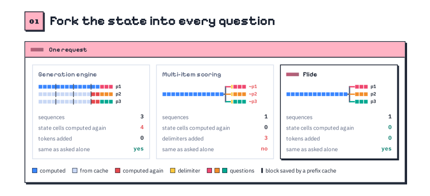
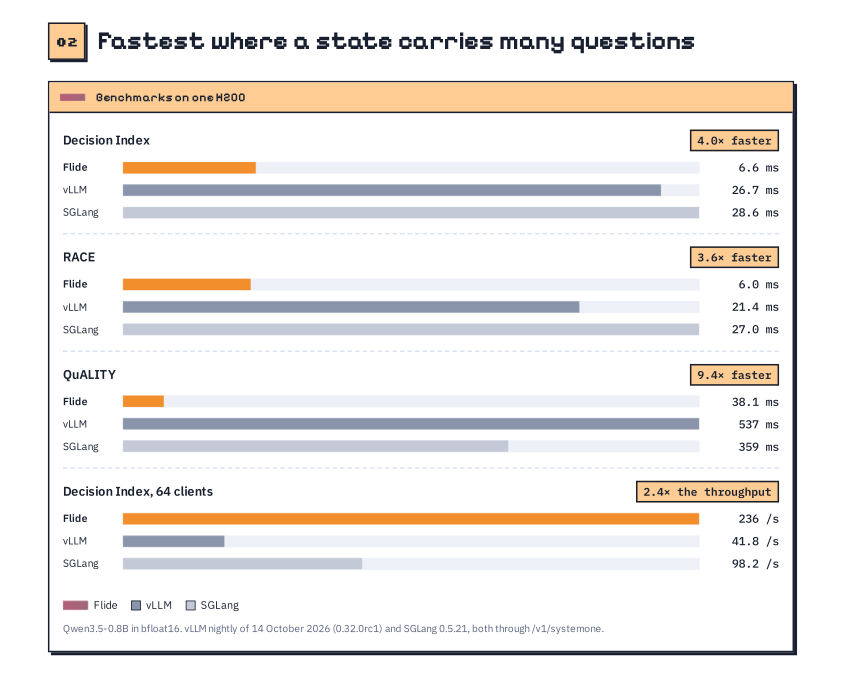
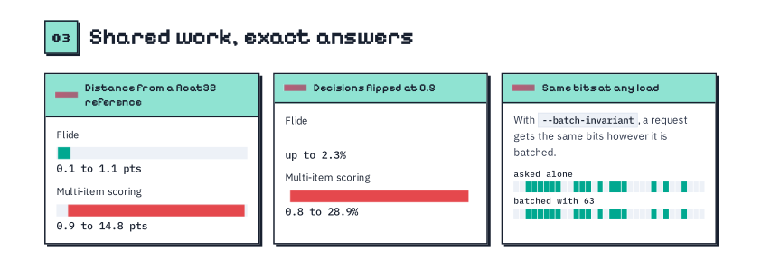

<p align="center">
  
</p>

<p align="center"><b>English</b> · <a href="assets/README_zh.md">简体中文</a> · <a href="assets/README_ja.md">日本語</a></p>

<p align="center">
  <a href="https://pypi.org/project/flide/"></a>
  <a href="https://github.com/OmniJev/Flide"></a>
  <a href="https://flide.org"></a>
  <a href="https://docs.flide.org"></a>
  <a href="LICENSE"></a>
  <a href="https://www.python.org"></a>
  <a href="https://pytorch.org"></a>
</p>

<p align="center"><a href="#-news">News</a> · <a href="#speed">Speed</a> · <a href="#exact-answers">Exact answers</a> · <a href="#quick-start">Quick start</a> · <a href="#models">Models</a> · <a href="#options">Options</a></p>

[Flide](https://docs.flide.org) is fast inference infrastructure for Jev-style decision models. With exact state forking it is up to 9.4 times faster than vLLM and SGLang, and every answer is the one the model gives the question alone. It serves the Jev `/v1/systemone` API.


## 🔥 News

- 🔥 **2026-10-29** We added two decision model families in Flide 0.1.6, including [Drex](https://huggingface.co/nace-ai/drex-v2.0) and [KnowLine](https://huggingface.co/PelaAI/KnowLine-35B-A3B-Gen1.5), and `flide verify` checks exact forking on your own model and requests.
- 🔥 **2026-10-28** We added six decision model families in Flide 0.1.5, including [Jeffan](https://huggingface.co/collections/tattrongvu/decision-model-6ad5c85a79bd246cc1c18c4a), [JevAny](https://huggingface.co/collections/SimpleJev/jevany-adaptive-decision-systems-6abc8fd39266b1c17b11b4e6), [Kev](https://huggingface.co/collections/jaredpalmer/kev-6aad9d0ea49f2589665e07cd), [Lychee](https://huggingface.co/LycheeAI/Lychee-27B), [pplx-decider](https://huggingface.co/perplexity-ai/pplx-decider-flash-v1.2) and [StartLux](https://huggingface.co/collections/startlux-models/startlux-decision-v11-instant-6aca8158623e8e001724cc82), and images for [Lumma](https://huggingface.co/collections/FrontiersMind/lumma-decision-models-6ab6356434b3db6856ec7ae6) and [mammoth](https://huggingface.co/baselabs/mammoth-1).
- 🔥 **2026-10-26** We added five decision model families in Flide 0.1.4, including [cerno](https://huggingface.co/apertixai/cerno-27b), [JADE](https://huggingface.co/theunnecessarythings/JADE), [Linne](https://huggingface.co/collections/PNPM244/decision-model-6ad363fb3351cecf1112a5a8), [mammoth](https://huggingface.co/baselabs/mammoth-1) and [Sieve](https://huggingface.co/collections/sthanika-ai/sieve-6abb93a61dd495f69811c586), and also [Quyet-1.0-Large](https://huggingface.co/chinhnc/Quyet-1.0-Large).
- 🔥 **2026-10-26** We added eight decision model families in Flide 0.1.3, including [AJev](https://huggingface.co/andyzhang232/ajev-gemma4-12b-lora7), [Bespoke-Nimble](https://huggingface.co/bespokelabs/Bespoke-Nimble-9B-v3), [Darwin](https://huggingface.co/collections/FINAL-Bench/ztc-models-jev-ecosystems-6aafa630afd69b39ead55aa8), [jiwo](https://huggingface.co/eljiwo/jiwo-4b), [Lumma](https://huggingface.co/collections/FrontiersMind/lumma-decision-models-6ab6356434b3db6856ec7ae6), [mogan](https://huggingface.co/moganai/mogan-decision-31B-it), [Quyet](https://huggingface.co/collections/chinhnc/quyet-10-6ac1b597a9a6a6806bb01fa6) and [Senova](https://huggingface.co/WangSenQWQ/Senova-4B), and LoRA adapters now serve as they are.
- 🔥 **2026-10-25** We added two decision model families in Flide 0.1.2, including [Intern-Decision](https://huggingface.co/collections/internlm/intern-decision-6ab75776af19ca84df0bc004) and [torchcast](https://huggingface.co/torchcast-ai/torchcast-decision-27b), and a question now takes up to 256 options.
- 🔥 **2026-10-24** We released Flide 0.1.0 on [PyPI](https://pypi.org/project/flide/), serving [Qwen3.5](https://huggingface.co/collections/Qwen/qwen35-6992e3053c019221cf2d725f) and [Gemma 4](https://huggingface.co/collections/google/gemma-4-69ce8ad93186d46744cb42f1) chat models and the [OneJev](https://huggingface.co/collections/OmniJev/onejev16-6ad27669cb868abe0516486d) and [Open-Jev](https://huggingface.co/collections/ZefanCai/open-jev-6ab049b9d43a267bae4dedc8) decision models. Welcome to have a try.


<p align="center">
  
</p>

With three questions, a generation engine runs three sequences and computes 4 cells of the state again, and multi-item scoring adds 3 delimiters that change the answers. Flide runs one sequence, computes nothing twice, adds no tokens, and gives each question the answer it gets when asked alone.

## Speed

<p align="center">
  
</p>

On one H200 with Qwen3.5-0.8B, Flide is up to 9.4 times faster than both vLLM and SGLang (QuALITY, where it is 14 times faster than vLLM), 3.6 to 4 times faster on RACE and the Decision Index, and serves 2.4 times the throughput with 64 clients. The more questions a state carries, the bigger the gap.

## Exact answers

<p align="center">
  
</p>

Flide stays within 1.1 points of a float32 reference, the closest of any engine, and flips at most 2.3% of decisions at 0.5. Multi-item scoring moves answers by up to 14.8 points and flips up to 28.9%. With `--batch-invariant`, a request gets the same bits however it is batched.

## Quick start

See the [docs](https://docs.flide.org) for every model, the API and all options.

### 1. Install

```bash
uv venv -p 3.12 && source .venv/bin/activate
uv pip install flide torchvision
```

### 2. Start a server

Any chat model on Qwen3.5 or Gemma 4 serves as it is and answers through its next token.

```bash
flide serve --model Qwen/Qwen3.5-4B
```

OneJev models read their answers their own way, and Flide serves them as they are too.

```bash
flide serve --model OmniJev/OneJev1.6-0.8B
```

An Open-Jev release is an adapter on a Qwen3.5 base. Merge it into a checkpoint once, then serve that.

```bash
python -m flide_open_jev.prepare ZefanCai/Open-Jev-2B open-jev-2b
flide serve --model open-jev-2b
```

`flide serve` listens on all interfaces at port 8000; pass `--host 127.0.0.1` to keep it local.

### 3. Send a request

```bash
curl http://localhost:8000/v1/systemone -H "Content-Type: application/json" -d '{
  "state": "Order #1182 arrived with a cracked screen. The customer asks for a refund and attached two photos.",
  "questions": {
    "action": {"type": "choice", "instructions": "What should support do next?",
               "criteria": {"refund": "refund the order", "replace": "send a replacement", "escalate": "ask a human"}},
    "urgent": {"type": "noul", "instructions": "Does this need a reply within the hour?"}
  }
}'
```

OneJev models also read images. Put `<image:1>` where the photo belongs in the state and send the photo in `media`.

```bash
IMG=$(base64 -w0 photo.jpg)
curl http://localhost:8000/v1/systemone -H "Content-Type: application/json" -d @- <<EOF
{
  "state": {"ticket": "Order #1182 arrived with a cracked screen. The customer asks for a refund.", "photo": "<image:1>"},
  "media": [{"type": "image", "data": "data:image/jpeg;base64,$IMG"}],
  "questions": {
    "cracked": {"type": "noul", "instructions": "The photo shows a cracked screen"},
    "action": {"type": "choice", "instructions": "What should support do next?",
               "criteria": {"refund": "refund the order", "replace": "send a replacement", "escalate": "ask a human"}}
  }
}
EOF
```

Every answer carries the probability of each option, ready for a threshold.

## Models

The last three columns say how much faster Flide answers one request than the engine its release ships, as the median latency over the requests of each workload on one H200, where DI is the Decision Index. The chat models run against the faster of vLLM and SGLang, and OneJev against qev, the engine it used before Flide. KnowLine runs with `--quantize fp8`, as its release serves it in FP8. A value marked ~ is the average over the sizes tested.

| Model | Inputs | DI | MultiRC | QuALITY |
|---|---|---:|---:|---:|
| [AJev](https://huggingface.co/andyzhang232/ajev-gemma4-12b-lora7) | text | 3.7× | 9.3× | 2.6× |
| [Bespoke-Nimble](https://huggingface.co/bespokelabs/Bespoke-Nimble-9B-v3) | text | 2.6× | 2.1× | 1.6× |
| [cerno](https://huggingface.co/apertixai/cerno-27b) | text | ~4.1× | ~8.6× | 1.1× |
| [Darwin](https://huggingface.co/collections/FINAL-Bench/ztc-models-jev-ecosystems-6aafa630afd69b39ead55aa8) | text | 1.6× | 7.0× | 1.2× |
| [Drex](https://huggingface.co/nace-ai/drex-v2.0) | text | ~3.4× | ~7.9× | ~1.7× |
| [Gemma 4](https://huggingface.co/collections/google/gemma-4-69ce8ad93186d46744cb42f1) | text, images | ~1.3× | ~1.7× | ~1.0× |
| [Intern-Decision](https://huggingface.co/collections/internlm/intern-decision-6ab75776af19ca84df0bc004) | text, images | 4.4× | 1.1× | 1.5× |
| [JADE](https://huggingface.co/theunnecessarythings/JADE) | text | 2.0× | 9.2× | 1.7× |
| [Jeffan](https://huggingface.co/collections/tattrongvu/decision-model-6ad5c85a79bd246cc1c18c4a) | text | 3.1× | 2.6× | 1.9× |
| [JevAny](https://huggingface.co/collections/SimpleJev/jevany-adaptive-decision-systems-6abc8fd39266b1c17b11b4e6) | text, images | 1.5× | 5.8× | 1.2× |
| [jiwo](https://huggingface.co/eljiwo/jiwo-4b) | text | ~1.9× | ~5.9× | 1.8× |
| [Kev](https://huggingface.co/collections/jaredpalmer/kev-6aad9d0ea49f2589665e07cd) | text | ~7.9× | ~1.5× | ~1.7× |
| [KnowLine](https://huggingface.co/PelaAI/KnowLine-35B-A3B-Gen1.5) | text | 1.3× | 5.4× | 1.2× |
| [Linne](https://huggingface.co/collections/PNPM244/decision-model-6ad363fb3351cecf1112a5a8) | text | 2.3× | 8.6× | 1.2× |
| [Lumma](https://huggingface.co/collections/FrontiersMind/lumma-decision-models-6ab6356434b3db6856ec7ae6) | text, images | 1.7× | 7.1× | 1.2× |
| [Lychee](https://huggingface.co/LycheeAI/Lychee-27B) | text | 1.4× | 1.5× | 1.4× |
| [mammoth](https://huggingface.co/baselabs/mammoth-1) | text, images | ~4.3× | ~2.8× | ~1.8× |
| [mogan](https://huggingface.co/moganai/mogan-decision-31B-it) | text | 1.6× | 8.5× | 1.8× |
| [OneJev](https://huggingface.co/collections/OmniJev/onejev16-6ad27669cb868abe0516486d) | text, images, video | ~6.8× | 7.3× | 4.7× |
| [Open-Jev](https://huggingface.co/collections/ZefanCai/open-jev-6ab049b9d43a267bae4dedc8) | text | 4.2× | 5.0× | ~1.5× |
| [pplx-decider](https://huggingface.co/perplexity-ai/pplx-decider-flash-v1.2) | text, images | 3.1× | 1.4× | 1.2× |
| [Quyet](https://huggingface.co/collections/chinhnc/quyet-10-6ac1b597a9a6a6806bb01fa6) | text | ~3.9× | ~7.1× | ~1.6× |
| [Qwen3.5](https://huggingface.co/collections/Qwen/qwen35-6992e3053c019221cf2d725f) | text, images | ~2.1× | ~4.8× | ~1.3× |
| [Senova](https://huggingface.co/WangSenQWQ/Senova-4B) | text | 3.1× | 28.1× | 1.2× |
| [Sieve](https://huggingface.co/collections/sthanika-ai/sieve-6abb93a61dd495f69811c586) | text | 3.0× | 14.3× | 2.6× |
| [StartLux](https://huggingface.co/collections/startlux-models/startlux-decision-v11-instant-6aca8158623e8e001724cc82) | text | 2.6× | 1.1× | 1.2× |
| [torchcast](https://huggingface.co/torchcast-ai/torchcast-decision-27b) | text, images | 1.6× | 8.4× | 1.4× |

## Options

| Option | What it does |
|---|---|
| `--session-cache-gb 40` | keeps the states of earlier requests, so an agent's next step reads only what is new |
| `--batch-invariant` | the same bits for a request whatever it is batched with, at some cost in speed |
| `--quantize fp8` | Qwen3.5 in FP8 on Ada, Hopper and Blackwell GPUs |
| `--frontends 2` | HTTP, rendering and tokenizing in two processes of their own, for many clients |

## License

Apache-2.0. `flide/kernels/gdn.py` holds a kernel derived from two kernels of
[flash-linear-attention](https://github.com/fla-org/flash-linear-attention) (MIT); THIRD_PARTY_NOTICES lists it with
the other code Flide builds on.
