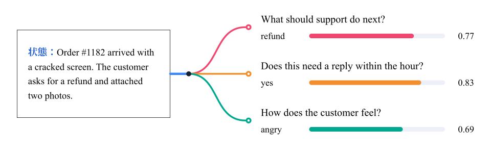
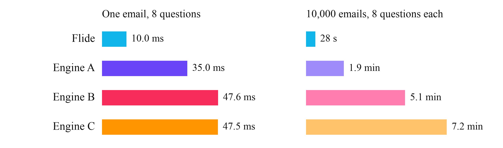

<p align="center">
  
</p>

<p align="center"><a href="../README.md">English</a> · <a href="README_zh.md">简体中文</a> · <b>日本語</b> · <a href="README_ko.md">한국어</a></p>

<p align="center">
  <a href="https://arxiv.org/abs/2610.42148"></a>
  <a href="https://pypi.org/project/flide/"></a>
  <a href="https://flide.org"></a>
  <a href="https://docs.flide.org"></a>
  <a href="../LICENSE"></a>
  <a href="https://www.python.org"></a>
  <a href="https://pytorch.org"></a>
</p>

<p align="center"><a href="#-ニュース">ニュース</a> · <a href="#クイックスタート">クイックスタート</a> · <a href="#モデル">モデル</a> · <a href="#オプション">オプション</a></p>

[Flide](https://docs.flide.org) は Jev 型の意思決定モデルのための高速な推論基盤です。厳密な状態分岐により vLLM や SGLang より最大 9.5 倍速く、どの答えもモデルがその質問だけに答えたときと同じです。API は Jev の `/v1/systemone` です。

<p align="center">
  
</p>

<p align="center">
  
</p>


## 🔥 ニュース

- 🔥 **2026-11-10** Flide 0.1.12 で [GLiDE](https://huggingface.co/collections/fastino/glide-6ada5467fb7eb6ac014fcc4b)、[Nimble-v4-max](https://huggingface.co/bespokelabs/Nimble-v4-max)、[clef-flash](https://huggingface.co/Cloudflare/clef-flash) に対応し、RTX 50 シリーズと RTX PRO 6000 向けのコンパイル済みカーネルを同梱しました。
- 🔥 **2026-11-10** Flide 0.1.11 で[メール仕分けのデモ](https://github.com/OmniJev/Flide/tree/main/demos/email_triage)を追加しました。H200 1 枚で 1 万通のメールそれぞれの 8 つの質問に 28 秒で答えます。
- 🔥 **2026-11-09** Flide 0.1.10 で [Ainvest-Decision](https://huggingface.co/Ainvest-World/Ainvest-Decision-27b-v1.0)、[Darwin-27B-RSI-Decision](https://huggingface.co/FINAL-Bench/Darwin-27B-RSI-Decision)、[KnowLine-31B-Gen1.5](https://huggingface.co/PelaAI/KnowLine-31B-Gen1.5) に対応し、KnowLine ファミリーが画像を読めるようになりました。

<details><summary>過去のニュース</summary>

- 🔥 **2026-11-09** Flide 0.1.9 で [pplx-decider-v1.1-27b](https://huggingface.co/perplexity-ai/pplx-decider-v1.1-27b)、[JEV-35B](https://huggingface.co/autotrust/JEV-35B) に対応し、`/v1/systemone` が 1 つのリクエスト本文で複数のリクエストを受け付けるようになりました。
- 🔥 **2026-11-08** Flide 0.1.8 で [AutoTrust](https://huggingface.co/collections/autotrust/autotrust-decision-models-6ada7050d1462de6733b7f98)、[Clef](https://huggingface.co/collections/Cloudflare/clef-6ac429cac15d70ee2af5d1c6) の 2 つの意思決定モデルファミリーを追加し、[drex-max-v1](https://huggingface.co/nace-ai/drex-max-v1) にも対応しました。
- 🔥 **2026-11-02** 論文 [Flide: Accelerating Decision Inference with Exact State Forking](https://arxiv.org/abs/2610.42148) を arXiv で公開しました。
- 🔥 **2026-10-29** Flide 0.1.7 で [SynACK Decide](https://huggingface.co/SkyPanther/synack-decide-26b-a4b)、[Wald](https://huggingface.co/collections/org2ai/wald)、[Xor](https://huggingface.co/juspay/Xor-26B-A4B) の 3 つの意思決定モデルファミリーを追加し、[KnowLine-26B-A4B](https://huggingface.co/PelaAI/KnowLine-26B-A4B-Gen2.5) などの Gemma 4 の混合エキスパートモデルに対応しました。
- 🔥 **2026-10-29** Flide 0.1.6 で [Drex](https://huggingface.co/nace-ai/drex-v2.0)、[KnowLine](https://huggingface.co/PelaAI/KnowLine-35B-A3B-Gen1.5) の 2 つの意思決定モデルファミリーを追加し、新しい `flide verify` で自分のモデルとリクエストの正確な分岐を確認できるようになりました。
- 🔥 **2026-10-28** Flide 0.1.5 で [Jeffan](https://huggingface.co/collections/tattrongvu/decision-model-6ad5c85a79bd246cc1c18c4a)、[JevAny](https://huggingface.co/collections/SimpleJev/jevany-adaptive-decision-systems-6abc8fd39266b1c17b11b4e6)、[Kev](https://huggingface.co/collections/jaredpalmer/kev-6aad9d0ea49f2589665e07cd)、[Lychee](https://huggingface.co/LycheeAI/Lychee-27B)、[pplx-decider](https://huggingface.co/perplexity-ai/pplx-decider-flash-v1.2)、[StartLux](https://huggingface.co/collections/startlux-models/startlux-decision-v11-instant-6aca8158623e8e001724cc82) の 6 つの意思決定モデルファミリーを追加し、[Lumma](https://huggingface.co/collections/FrontiersMind/lumma-decision-models-6ab6356434b3db6856ec7ae6) と [mammoth](https://huggingface.co/baselabs/mammoth-1) で画像入力にも対応しました。
- 🔥 **2026-10-26** Flide 0.1.4 で [cerno](https://huggingface.co/apertixai/cerno-27b)、[JADE](https://huggingface.co/theunnecessarythings/JADE)、[Linne](https://huggingface.co/collections/PNPM244/decision-model-6ad363fb3351cecf1112a5a8)、[mammoth](https://huggingface.co/baselabs/mammoth-1)、[Sieve](https://huggingface.co/collections/sthanika-ai/sieve-6abb93a61dd495f69811c586) の 5 つの意思決定モデルファミリーを追加し、[Quyet-1.0-Large](https://huggingface.co/chinhnc/Quyet-1.0-Large) にも対応しました。
- 🔥 **2026-10-26** Flide 0.1.3 で [AJev](https://huggingface.co/andyzhang232/ajev-gemma4-12b-lora7)、[Bespoke-Nimble](https://huggingface.co/bespokelabs/Bespoke-Nimble-9B-v3)、[Darwin](https://huggingface.co/collections/FINAL-Bench/ztc-models-jev-ecosystems-6aafa630afd69b39ead55aa8)、[jiwo](https://huggingface.co/eljiwo/jiwo-4b)、[Lumma](https://huggingface.co/collections/FrontiersMind/lumma-decision-models-6ab6356434b3db6856ec7ae6)、[mogan](https://huggingface.co/moganai/mogan-decision-31B-it)、[Quyet](https://huggingface.co/collections/chinhnc/quyet-10-6ac1b597a9a6a6806bb01fa6)、[Senova](https://huggingface.co/WangSenQWQ/Senova-4B) の 8 つの意思決定モデルファミリーを追加し、LoRA アダプターもそのまま提供できるようになりました。
- 🔥 **2026-10-25** Flide 0.1.2 で [Intern-Decision](https://huggingface.co/collections/internlm/intern-decision-6ab75776af19ca84df0bc004)、[torchcast](https://huggingface.co/torchcast-ai/torchcast-decision-27b) の 2 つの意思決定モデルファミリーを追加し、1 問あたり最大 256 個の選択肢に対応しました。
- 🔥 **2026-10-24** Flide 0.1.0 を [PyPI](https://pypi.org/project/flide/) で公開しました。[Qwen3.5](https://huggingface.co/collections/Qwen/qwen35-6992e3053c019221cf2d725f) と [Gemma 4](https://huggingface.co/collections/google/gemma-4-69ce8ad93186d46744cb42f1) のチャットモデル、[OneJev](https://huggingface.co/collections/OmniJev/onejev16-6ad27669cb868abe0516486d) と [Open-Jev](https://huggingface.co/collections/ZefanCai/open-jev-6ab049b9d43a267bae4dedc8) の意思決定モデルに対応しています。ぜひお試しください。

</details>

## クイックスタート

各モデルの使い方、画像、API、すべてのオプションは[ドキュメント](https://docs.flide.org)を参照してください。

```bash
uv venv -p 3.12 && source .venv/bin/activate
uv pip install flide torchvision
flide serve --model OmniJev/OneJev1.6-0.8B
```

[モデル表](#モデル)のどのモデルも同じように起動でき、たとえば Perplexity の意思決定モデルはこうです。

```bash
flide serve --model perplexity-ai/pplx-decider-flash-v1.2
```

どのモデルもこのリクエストに答えます。

```bash
curl http://localhost:8000/v1/systemone -H "Content-Type: application/json" -d '{
  "state": "Order #1182 arrived with a cracked screen. The customer asks for a refund and attached two photos.",
  "questions": {
    "action": {"type": "choice", "instructions": "What should support do next?",
               "criteria": {"refund": "refund the order", "replace": "send a replacement", "escalate": "ask a human"}},
    "urgent": {"type": "noul", "instructions": "Does this need a reply within the hour?"}
  }
}'
```

## 例

Flide は 1 万通のメールそれぞれの 8 つの質問に、わずか 28 秒で答えます。[メール仕分けのデモ](https://github.com/OmniJev/Flide/tree/main/demos/email_triage)に自分で動かすためのコードがあります。

<p align="center">
  
</p>

<p align="center">
  
</p>

H200 1 枚と OneJev1.6-0.8B で、Flide は 1 通を 10.0 ms、1 万通を 28 秒で答えます。ほかのエンジンで最速のものと比べて、それぞれ 3.5 倍と 4.1 倍の速さです。

## モデル

最後の 3 列は、1 リクエストに答えるのに Flide がリリース付属のエンジンより何倍速いかを示し、各データセットのリクエストの中央値レイテンシを H200 1 枚で測っています。DI は Decision Index です。チャットモデルは vLLM と SGLang の速いほう、OneJev は Flide の前に使っていた qev と比べ、KnowLine 35B はリリース版と同じく FP8（`--quantize fp8`）で動かしており、~ の付いた値は試したサイズの平均です。

| モデル | 入力 | DI | MultiRC | QuALITY |
|---|---|---:|---:|---:|
| [Ainvest-Decision](https://huggingface.co/Ainvest-World/Ainvest-Decision-27b-v1.0) | テキスト | 1.4× | 1.3× | 1.3× |
| [AJev](https://huggingface.co/andyzhang232/ajev-gemma4-12b-lora7) | テキスト | 3.7× | 9.3× | 2.6× |
| [AutoTrust](https://huggingface.co/collections/autotrust/autotrust-decision-models-6ada7050d1462de6733b7f98) | テキスト、画像 | ~3.2× | ~7.6× | ~1.6× |
| [Bespoke-Nimble](https://huggingface.co/bespokelabs/Nimble-v4-max) | テキスト | ~2.1× | ~1.8× | ~1.5× |
| [cerno](https://huggingface.co/apertixai/cerno-27b) | テキスト | ~4.1× | ~8.6× | 1.1× |
| [Clef](https://huggingface.co/collections/Cloudflare/clef-6ac429cac15d70ee2af5d1c6) | テキスト、画像 | ~1.7× | ~1.1× | ~1.0× |
| [Darwin](https://huggingface.co/collections/FINAL-Bench/ztc-models-jev-ecosystems-6aafa630afd69b39ead55aa8) | テキスト | ~1.4× | ~4.2× | ~1.2× |
| [Drex](https://huggingface.co/nace-ai/drex-v2.0) | テキスト、画像 | ~2.8× | ~6.2× | ~1.5× |
| [Gemma 4](https://huggingface.co/collections/google/gemma-4-69ce8ad93186d46744cb42f1) | テキスト、画像 | ~1.3× | ~1.7× | ~1.0× |
| [GLiDE](https://huggingface.co/collections/fastino/glide-6ada5467fb7eb6ac014fcc4b) | テキスト | ~6.4× | ~1.9× | ~1.8× |
| [Intern-Decision](https://huggingface.co/collections/internlm/intern-decision-6ab75776af19ca84df0bc004) | テキスト、画像 | 4.4× | 1.1× | 1.5× |
| [JADE](https://huggingface.co/theunnecessarythings/JADE) | テキスト | 2.0× | 9.2× | 1.7× |
| [Jeffan](https://huggingface.co/collections/tattrongvu/decision-model-6ad5c85a79bd246cc1c18c4a) | テキスト | 3.1× | 2.6× | 1.9× |
| [JevAny](https://huggingface.co/collections/SimpleJev/jevany-adaptive-decision-systems-6abc8fd39266b1c17b11b4e6) | テキスト、画像 | 1.5× | 5.8× | 1.2× |
| [jiwo](https://huggingface.co/eljiwo/jiwo-4b) | テキスト | ~1.9× | ~5.9× | 1.8× |
| [Kev](https://huggingface.co/collections/jaredpalmer/kev-6aad9d0ea49f2589665e07cd) | テキスト | ~7.9× | ~1.5× | ~1.7× |
| [KnowLine](https://huggingface.co/PelaAI/KnowLine-35B-A3B-Gen1.5) | テキスト、画像 | ~1.4× | ~4.3× | ~1.5× |
| [Linne](https://huggingface.co/collections/PNPM244/decision-model-6ad363fb3351cecf1112a5a8) | テキスト | 2.3× | 8.6× | 1.2× |
| [Lumma](https://huggingface.co/collections/FrontiersMind/lumma-decision-models-6ab6356434b3db6856ec7ae6) | テキスト、画像 | 1.7× | 7.1× | 1.2× |
| [Lychee](https://huggingface.co/LycheeAI/Lychee-27B) | テキスト | 1.4× | 1.5× | 1.4× |
| [mammoth](https://huggingface.co/baselabs/mammoth-1) | テキスト、画像 | ~4.3× | ~2.8× | ~1.8× |
| [mogan](https://huggingface.co/moganai/mogan-decision-31B-it) | テキスト | 1.6× | 8.5× | 1.8× |
| [OneJev](https://huggingface.co/collections/OmniJev/onejev16-6ad27669cb868abe0516486d) | テキスト、画像、動画 | ~6.8× | 7.3× | 4.7× |
| [Open-Jev](https://huggingface.co/collections/ZefanCai/open-jev-6ab049b9d43a267bae4dedc8) | テキスト | 4.2× | 5.0× | ~1.5× |
| [pplx-decider](https://huggingface.co/perplexity-ai/pplx-decider-flash-v1.2) | テキスト、画像 | ~2.2× | ~1.4× | ~1.3× |
| [Quyet](https://huggingface.co/collections/chinhnc/quyet-10-6ac1b597a9a6a6806bb01fa6) | テキスト | ~3.9× | ~7.1× | ~1.6× |
| [Qwen3.5](https://huggingface.co/collections/Qwen/qwen35-6992e3053c019221cf2d725f) | テキスト、画像 | ~2.1× | ~4.8× | ~1.3× |
| [Senova](https://huggingface.co/WangSenQWQ/Senova-4B) | テキスト | 3.1× | 28.1× | 1.2× |
| [Sieve](https://huggingface.co/collections/sthanika-ai/sieve-6abb93a61dd495f69811c586) | テキスト | 3.0× | 14.3× | 2.6× |
| [StartLux](https://huggingface.co/collections/startlux-models/startlux-decision-v11-instant-6aca8158623e8e001724cc82) | テキスト | 2.6× | 1.1× | 1.2× |
| [SynACK Decide](https://huggingface.co/SkyPanther/synack-decide-26b-a4b) | テキスト | 3.3× | 11.9× | 3.0× |
| [torchcast](https://huggingface.co/torchcast-ai/torchcast-decision-27b) | テキスト、画像 | 1.6× | 8.4× | 1.4× |
| [Wald](https://huggingface.co/collections/org2ai/wald) | テキスト | 1.6× | 12.7× | 1.5× |
| [Xor](https://huggingface.co/juspay/Xor-26B-A4B) | テキスト、画像、動画 | 2.5× | 6.2× | 2.8× |

## オプション

| オプション | 内容 |
|---|---|
| `--session-cache-gb 40` | 以前のリクエストの状態を保存し、エージェントの次のステップは新しい部分だけを読む |
| `--batch-invariant` | どのリクエストと同じバッチでも、同じリクエストはビット単位で同じ結果になる（少し遅くなる） |
| `--quantize fp8` | Ada、Hopper、Blackwell の GPU で Qwen3.5 を FP8 で動かす |
| `--frontends 2` | HTTP、レンダリング、トークン化を 2 つの専用プロセスで行う（クライアントが多いとき向け） |

## ライセンス

Apache-2.0。`flide/kernels/gdn.py` には [flash-linear-attention](https://github.com/fla-org/flash-linear-attention)（MIT）の 2 つのカーネルから派生したカーネルが含まれます。THIRD_PARTY_NOTICES に、それと Flide が利用しているほかのコードを記載しています。

## 引用

研究で Flide を使われた場合は、[論文](https://arxiv.org/abs/2610.42148)を引用してください。

```bibtex
@article{li2026flide,
  title   = {Flide: Accelerating Decision Inference with Exact State Forking},
  author  = {Li, Bobo and Song, Jiajia and Fei, Hao and Hsu, Wynne and Lee, Mong Li},
  journal = {arXiv preprint arXiv:2610.42148},
  year    = {2026}
}
```
