<p align="center">
  
</p>

<p align="center"><a href="../README.md">English</a> · <a href="README_zh.md">简体中文</a> · <b>日本語</b></p>

<p align="center">
  <a href="https://pypi.org/project/flide/"></a>
  <a href="https://github.com/OmniJev/Flide"></a>
  <a href="https://flide.org"></a>
  <a href="https://docs.flide.org"></a>
  <a href="../LICENSE"></a>
  <a href="https://www.python.org"></a>
  <a href="https://pytorch.org"></a>
</p>

<p align="center"><a href="#-ニュース">ニュース</a> · <a href="#速度">速度</a> · <a href="#正確な答え">正確な答え</a> · <a href="#クイックスタート">クイックスタート</a> · <a href="#モデル">モデル</a> · <a href="#オプション">オプション</a></p>

[Flide](https://docs.flide.org) は意思決定モデルのための推論エンジンです。1 つのリクエストには、エージェントの軌跡や文書のような状態と、それについての型付きの質問が入ります。Flide は 1 回の順伝播の中で状態をすべての質問に分岐させるので、状態は一度だけ読まれ、どの質問も単独で聞いたときと同じ答えを受け取ります。答えは確率として、vLLM や SGLang も提供する
`/v1/systemone` API で返ります。


## 🔥 ニュース

- 🔥 **2026-10-25** Flide 0.1.2 で意思決定モデルのファミリーを 2 つ（Intern-Decision、torchcast）追加し、1 問あたり最大 256 個の選択肢に対応しました。PR を歓迎します。
- 🔥 **2026-10-24** Flide 0.1.0 を [PyPI](https://pypi.org/project/flide/) で公開しました。ぜひお試しください。


<p align="center">
  
</p>

質問が 3 つの場合、生成エンジンは 3 本のシーケンスを走らせて状態の 4 マスを再計算し、マルチアイテム採点は区切り記号を 3 つ足して答えを変えてしまいます。Flide は 1 本のシーケンスで済み、何も再計算せず、トークンも足さず、どの質問も単独で聞いたときと同じ答えになります。

## 速度

<p align="center">
  
</p>

H200 1 枚で Qwen3.5-0.8B を動かすと、Flide は vLLM と SGLang のどちらよりも最大 9.4 倍速く（QuALITY、vLLM 比では 14 倍）、RACE と Decision Index では 3.6 から 4 倍速く、64 クライアントではスループットが 2.4 倍になります。1 つの状態が抱える質問が多いほど、差は広がります。

## 正確な答え

<p align="center">
  
</p>

Flide は float32 の参照から 1.1 ポイント以内に収まり、どのエンジンよりも近く、0.5 で反転する判定は最大 2.3% です。マルチアイテム採点は答えを最大 14.8 ポイント動かし、判定を最大 28.9% 反転させます。`--batch-invariant` を付けると、どうバッチされても同じリクエストは同じビットを返します。

## クイックスタート

モデル、API、すべてのオプションは[ドキュメント](https://docs.flide.org)を参照してください。

### 1. インストール

```bash
uv venv -p 3.12 && source .venv/bin/activate
uv pip install flide torchvision
```

### 2. サーバーを起動する

Qwen3.5 と Gemma 4 上のチャットモデルはそのまま起動でき、次のトークンで答えます。

```bash
flide serve --model Qwen/Qwen3.5-4B
```

独自の方法で答えを読む OneJev も、そのまま起動できます。

```bash
flide serve --model OmniJev/OneJev1.6-0.8B
```

Open-Jev は Qwen3.5 ベースのアダプタとして公開されています。一度チェックポイントにマージしてから起動します。

```bash
python -m flide_open_jev.prepare ZefanCai/Open-Jev-2B open-jev-2b
flide serve --model open-jev-2b
```

`flide serve` はすべてのインターフェースのポート 8000 で待ち受けます。ローカルだけにするには `--host 127.0.0.1` を付けてください。

### 3. リクエストを送る

```bash
curl http://localhost:8000/v1/systemone -H "Content-Type: application/json" -d '{
  "state": "Order #1182 arrived with a cracked screen. The customer asks for a refund and attached two photos.",
  "questions": {
    "action": {"type": "choice", "instructions": "What should support do next?",
               "criteria": {"refund": "refund the order", "replace": "send a replacement", "escalate": "ask a human"}},
    "urgent": {"type": "noul", "instructions": "Does this need a reply within the hour?"}
  }
}'
```

OneJev モデルは画像も読めます。state の中で写真が入る位置に `<image:1>` と書き、写真を `media` に入れて一緒に送ります。

```bash
IMG=$(base64 -w0 photo.jpg)
curl http://localhost:8000/v1/systemone -H "Content-Type: application/json" -d @- <<EOF
{
  "state": {"ticket": "Order #1182 arrived with a cracked screen. The customer asks for a refund.", "photo": "<image:1>"},
  "media": [{"type": "image", "data": "data:image/jpeg;base64,$IMG"}],
  "questions": {
    "cracked": {"type": "noul", "instructions": "The photo shows a cracked screen"},
    "action": {"type": "choice", "instructions": "What should support do next?",
               "criteria": {"refund": "refund the order", "replace": "send a replacement", "escalate": "ask a human"}}
  }
}
EOF
```

答えにはそれぞれの選択肢の確率が付くので、そのまましきい値と比べられます。

## モデル

| モデル | チェックポイント | 入力 |
|---|---|---|
| [Gemma 4](https://huggingface.co/collections/google/gemma-4-69ce8ad93186d46744cb42f1) | `google/gemma-4-E2B-it`, `-E4B-it`, `-12B-it`, `-31B-it` | テキスト、画像 |
| [Intern-Decision](https://huggingface.co/collections/internlm/intern-decision-6ab75776af19ca84df0bc004) | `internlm/Intern-Decision-4B`, `-2B`, `-0.8B` | テキスト |
| [OneJev](https://huggingface.co/collections/OmniJev/onejev16-6ad27669cb868abe0516486d) | `OmniJev/OneJev1.6-0.8B`, `-4B`, `-9B`, `-27B` | テキスト、画像、動画 |
| [Open-Jev](https://huggingface.co/collections/ZefanCai/open-jev-6ab049b9d43a267bae4dedc8) | `ZefanCai/Open-Jev-2B`, `-9B` | テキスト |
| [Qwen3.5](https://huggingface.co/collections/Qwen/qwen35-6992e3053c019221cf2d725f) | `Qwen/Qwen3.5-0.8B`, `-2B`, `-4B`, `-9B`, `-27B` | テキスト、画像 |
| [torchcast](https://huggingface.co/torchcast-ai/torchcast-decision-27b) | `torchcast-ai/torchcast-decision-27b` | テキスト |

Qwen3.5 か Gemma 4 をベースにしたチャットモデルはそのまま使えます。表にあるのは公式版です。ほかの行は意思決定モデルで、それぞれのリリースと同じ方法で答えを読みます。新しいモデルファミリーは `plugins/` にディレクトリを 1 つ加え、
`pyproject.toml` に 1 行登録するだけです。別パッケージとして `flide.formats` エントリポイントから加えることもできます。

## オプション

| オプション | 内容 |
|---|---|
| `--session-cache-gb 40` | 以前のリクエストの状態を保存し、エージェントの次のステップは新しい部分だけを読む |
| `--batch-invariant` | どのリクエストと同じバッチでも、同じリクエストはビット単位で同じ結果になる（少し遅くなる） |
| `--quantize fp8` | Ada、Hopper、Blackwell の GPU で Qwen3.5 を FP8 で動かす |
| `--frontends 2` | HTTP、レンダリング、トークン化を 2 つの専用プロセスで行う（クライアントが多いとき向け） |

## ライセンス

Apache-2.0。`flide/kernels/gdn.py` には [flash-linear-attention](https://github.com/fla-org/flash-linear-attention)（MIT）の 2 つのカーネルから派生したカーネルが含まれます。THIRD_PARTY_NOTICES に、それと Flide が利用しているほかのコードを記載しています。
