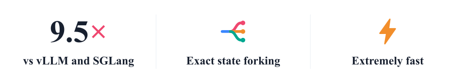
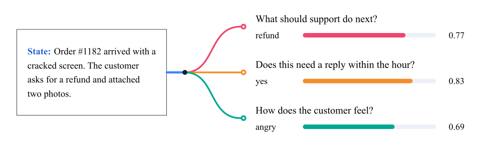
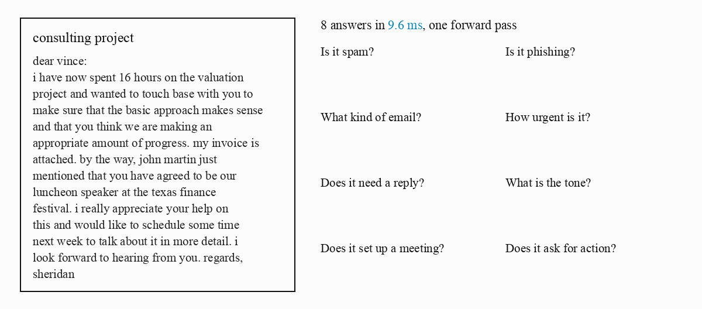
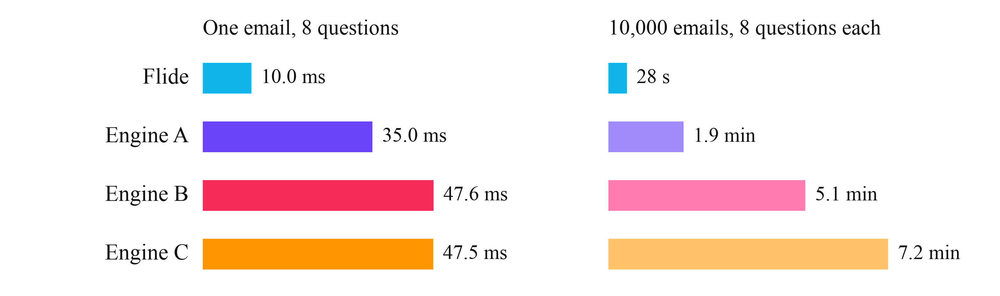

<p align="center">
  
</p>

<p align="center"><a href="../README.md">English</a> · <a href="README_zh.md">简体中文</a> · <a href="README_ja.md">日本語</a> · <b>한국어</b></p>

<p align="center">
  <a href="https://arxiv.org/abs/2610.42148"></a>
  <a href="https://pypi.org/project/flide/"></a>
  <a href="https://flide.org"></a>
  <a href="https://docs.flide.org"></a>
  <a href="../LICENSE"></a>
  <a href="https://www.python.org"></a>
  <a href="https://pytorch.org"></a>
</p>

<p align="center"><a href="#-뉴스">뉴스</a> · <a href="#빠른-시작">빠른 시작</a> · <a href="#모델">모델</a> · <a href="#옵션">옵션</a></p>

[Flide](https://docs.flide.org)는 Jev 방식 의사결정 모델을 위한 빠른 추론 인프라입니다. 정확한 상태 포킹으로 vLLM과 SGLang보다 최대 9.5배 빠르며, 모든 답은 모델이 그 질문 하나만 받았을 때의 답과 같습니다. Jev `/v1/systemone` API를 제공합니다.

<p align="center">
  
</p>

<p align="center">
  
</p>


## 🔥 뉴스

- 🔥 **2026-11-12** Flide 0.1.15에 LiquidAI의 [d1-3B](https://huggingface.co/LiquidAI/d1-3B)를 추가하고, Gemma 4도 `--quantize fp8`로 FP8로 실행되어 Gemma 4 12B가 24 GB 카드 한 장에 들어갑니다.
- 🔥 **2026-11-12** Flide 0.1.14에 [GLiDE-9B](https://huggingface.co/fastino/GLiDE-9B), [GLiDE-27B](https://huggingface.co/fastino/GLiDE-27B)를 추가하고, GLiDE-27B는 이미지도 읽습니다.
- 🔥 **2026-11-11** Flide 0.1.13에 [FlexDM-LoRA-v2.1](https://huggingface.co/1000luca/FlexDM-LoRA-v2.1), [Sieve-31B-v3](https://huggingface.co/sthanika-ai/Sieve-31B-v3), [JDI-Decision-V1](https://huggingface.co/JoyIndustrial/JDI-Decision-V1)를 추가하고, RTX 40 시리즈 GPU용 사전 컴파일 커널을 넣었습니다.

<details><summary>이전 뉴스</summary>

- 🔥 **2026-11-10** Flide 0.1.12에 [GLiDE](https://huggingface.co/collections/fastino/glide-6ada5467fb7eb6ac014fcc4b), [Nimble-v4-max](https://huggingface.co/bespokelabs/Nimble-v4-max), [clef-flash](https://huggingface.co/Cloudflare/clef-flash)를 추가하고, RTX 50 시리즈와 RTX PRO 6000 GPU용 사전 컴파일 커널을 넣었습니다.
- 🔥 **2026-11-10** Flide 0.1.11에 [이메일 분류 데모](https://github.com/OmniJev/Flide/tree/main/demos/email_triage)를 추가했습니다. H200 한 장으로 이메일 10,000통에 각각 8개의 질문을 28초 만에 답합니다.
- 🔥 **2026-11-09** Flide 0.1.10에 [Ainvest-Decision](https://huggingface.co/Ainvest-World/Ainvest-Decision-27b-v1.0), [Darwin-27B-RSI-Decision](https://huggingface.co/FINAL-Bench/Darwin-27B-RSI-Decision), [KnowLine-31B-Gen1.5](https://huggingface.co/PelaAI/KnowLine-31B-Gen1.5)를 추가했고, KnowLine 계열이 이제 이미지를 읽습니다.
- 🔥 **2026-11-09** Flide 0.1.9에 [pplx-decider-v1.1-27b](https://huggingface.co/perplexity-ai/pplx-decider-v1.1-27b)와 [JEV-35B](https://huggingface.co/autotrust/JEV-35B)를 추가했고, `/v1/systemone`이 이제 하나의 본문에 여러 요청을 받습니다.
- 🔥 **2026-11-08** Flide 0.1.8에 [AutoTrust](https://huggingface.co/collections/autotrust/autotrust-decision-models-6ada7050d1462de6733b7f98), [Clef](https://huggingface.co/collections/Cloudflare/clef-6ac429cac15d70ee2af5d1c6)를 포함한 두 의사결정 모델 계열과 [drex-max-v1](https://huggingface.co/nace-ai/drex-max-v1)를 추가했습니다.
- 🔥 **2026-11-02** 논문 [Flide: Accelerating Decision Inference with Exact State Forking](https://arxiv.org/abs/2610.42148)을 arXiv에 공개했습니다.
- 🔥 **2026-10-29** Flide 0.1.7에 [SynACK Decide](https://huggingface.co/SkyPanther/synack-decide-26b-a4b), [Wald](https://huggingface.co/collections/org2ai/wald), [Xor](https://huggingface.co/juspay/Xor-26B-A4B)를 포함한 세 의사결정 모델 계열과, [KnowLine-26B-A4B](https://huggingface.co/PelaAI/KnowLine-26B-A4B-Gen2.5) 같은 Gemma 4 전문가 혼합 모델을 추가했습니다.
- 🔥 **2026-10-29** Flide 0.1.6에 [Drex](https://huggingface.co/nace-ai/drex-v2.0), [KnowLine](https://huggingface.co/PelaAI/KnowLine-35B-A3B-Gen1.5)을 포함한 두 의사결정 모델 계열을 추가했고, `flide verify`로 직접 고른 모델과 요청에서 정확한 포킹을 확인할 수 있습니다.
- 🔥 **2026-10-28** Flide 0.1.5에 [Jeffan](https://huggingface.co/collections/tattrongvu/decision-model-6ad5c85a79bd246cc1c18c4a), [JevAny](https://huggingface.co/collections/SimpleJev/jevany-adaptive-decision-systems-6abc8fd39266b1c17b11b4e6), [Kev](https://huggingface.co/collections/jaredpalmer/kev-6aad9d0ea49f2589665e07cd), [Lychee](https://huggingface.co/LycheeAI/Lychee-27B), [pplx-decider](https://huggingface.co/perplexity-ai/pplx-decider-flash-v1.2), [StartLux](https://huggingface.co/collections/startlux-models/startlux-decision-v11-instant-6aca8158623e8e001724cc82)를 포함한 여섯 의사결정 모델 계열과, [Lumma](https://huggingface.co/collections/FrontiersMind/lumma-decision-models-6ab6356434b3db6856ec7ae6), [mammoth](https://huggingface.co/baselabs/mammoth-1)의 이미지 입력을 추가했습니다.
- 🔥 **2026-10-26** Flide 0.1.4에 [cerno](https://huggingface.co/apertixai/cerno-27b), [JADE](https://huggingface.co/theunnecessarythings/JADE), [Linne](https://huggingface.co/collections/PNPM244/decision-model-6ad363fb3351cecf1112a5a8), [mammoth](https://huggingface.co/baselabs/mammoth-1), [Sieve](https://huggingface.co/collections/sthanika-ai/sieve-6abb93a61dd495f69811c586)를 포함한 다섯 의사결정 모델 계열과 [Quyet-1.0-Large](https://huggingface.co/chinhnc/Quyet-1.0-Large)를 추가했습니다.
- 🔥 **2026-10-26** Flide 0.1.3에 [AJev](https://huggingface.co/andyzhang232/ajev-gemma4-12b-lora7), [Bespoke-Nimble](https://huggingface.co/bespokelabs/Bespoke-Nimble-9B-v3), [Darwin](https://huggingface.co/collections/FINAL-Bench/ztc-models-jev-ecosystems-6aafa630afd69b39ead55aa8), [jiwo](https://huggingface.co/eljiwo/jiwo-4b), [Lumma](https://huggingface.co/collections/FrontiersMind/lumma-decision-models-6ab6356434b3db6856ec7ae6), [mogan](https://huggingface.co/moganai/mogan-decision-31B-it), [Quyet](https://huggingface.co/collections/chinhnc/quyet-10-6ac1b597a9a6a6806bb01fa6), [Senova](https://huggingface.co/WangSenQWQ/Senova-4B)을 포함한 여덟 의사결정 모델 계열을 추가했고, LoRA 어댑터를 그대로 서빙합니다.
- 🔥 **2026-10-25** Flide 0.1.2에 [Intern-Decision](https://huggingface.co/collections/internlm/intern-decision-6ab75776af19ca84df0bc004), [torchcast](https://huggingface.co/torchcast-ai/torchcast-decision-27b)를 포함한 두 의사결정 모델 계열을 추가했고, 이제 한 질문에 선택지를 최대 256개까지 줄 수 있습니다.
- 🔥 **2026-10-24** Flide 0.1.0을 [PyPI](https://pypi.org/project/flide/)에 공개했습니다. [Qwen3.5](https://huggingface.co/collections/Qwen/qwen35-6992e3053c019221cf2d725f), [Gemma 4](https://huggingface.co/collections/google/gemma-4-69ce8ad93186d46744cb42f1) 채팅 모델과 [OneJev](https://huggingface.co/collections/OmniJev/onejev16-6ad27669cb868abe0516486d), [Open-Jev](https://huggingface.co/collections/ZefanCai/open-jev-6ab049b9d43a267bae4dedc8) 의사결정 모델을 서빙합니다. 한번 사용해 보세요.

</details>

## 빠른 시작

Flide는 NVIDIA GPU가 필요하며 Linux 또는 Windows WSL2에서 실행됩니다. 모든 모델, 이미지, API, 전체 옵션은 [문서](https://docs.flide.org)를 참고하세요.

```bash
uv venv -p 3.12 && source .venv/bin/activate
uv pip install flide torchvision
flide serve --model OmniJev/OneJev1.6-0.8B
```

[모델 표](#모델)의 어떤 모델이든 같은 방식으로 시작합니다. 예를 들어 Perplexity의 의사결정 모델은 이렇게 실행합니다.

```bash
flide serve --model perplexity-ai/pplx-decider-flash-v1.2
```

모든 모델이 이 요청에 답합니다.

```bash
curl http://localhost:8000/v1/systemone -H "Content-Type: application/json" -d '{
  "state": "Order #1182 arrived with a cracked screen. The customer asks for a refund and attached two photos.",
  "questions": {
    "action": {"type": "choice", "instructions": "What should support do next?",
               "criteria": {"refund": "refund the order", "replace": "send a replacement", "escalate": "ask a human"}},
    "urgent": {"type": "noul", "instructions": "Does this need a reply within the hour?"}
  }
}'
```

## 예시

Flide는 이메일 10,000통 각각의 질문 8개에 단 28초 만에 답합니다. [이메일 분류 데모](https://github.com/OmniJev/Flide/tree/main/demos/email_triage)에 직접 실행해 볼 수 있는 코드가 있습니다.

<p align="center">
  
</p>

<p align="center">
  
</p>

H200 한 장과 OneJev1.6-0.8B로 Flide는 이메일 한 통을 10.0 ms에, 10,000통 전체를 28초에 답합니다. 다른 엔진 중 가장 빠른 것보다 각각 3.5배, 4.1배 빠릅니다.

## 모델

마지막 세 열은 Flide가 각 모델의 릴리스에 포함된 엔진보다 한 요청에 몇 배 빨리 답하는지를 보여 줍니다. H200 한 장에서 각 워크로드 요청들의 중앙값 지연 시간으로 측정했으며, DI는 Decision Index입니다. 채팅 모델은 vLLM과 SGLang 중 더 빠른 쪽과, OneJev는 Flide 이전에 쓰던 엔진인 qev와 비교했습니다. KnowLine 35B는 릴리스가 FP8로 서빙하므로 `--quantize fp8`로 실행했습니다. ~가 붙은 값은 테스트한 크기들의 평균입니다.

| 모델 | 입력 | DI | MultiRC | QuALITY |
|---|---|---:|---:|---:|
| [Ainvest-Decision](https://huggingface.co/Ainvest-World/Ainvest-Decision-27b-v1.0) | 텍스트 | 1.4× | 1.3× | 1.3× |
| [AJev](https://huggingface.co/andyzhang232/ajev-gemma4-12b-lora7) | 텍스트 | 3.7× | 9.3× | 2.6× |
| [AutoTrust](https://huggingface.co/collections/autotrust/autotrust-decision-models-6ada7050d1462de6733b7f98) | 텍스트, 이미지 | ~3.2× | ~7.6× | ~1.6× |
| [Bespoke-Nimble](https://huggingface.co/bespokelabs/Nimble-v4-max) | 텍스트 | ~2.1× | ~1.8× | ~1.5× |
| [cerno](https://huggingface.co/apertixai/cerno-27b) | 텍스트 | ~4.1× | ~8.6× | 1.1× |
| [Clef](https://huggingface.co/collections/Cloudflare/clef-6ac429cac15d70ee2af5d1c6) | 텍스트, 이미지 | ~1.7× | ~1.1× | ~1.0× |
| [d1](https://huggingface.co/LiquidAI/d1-3B) | 텍스트, 이미지 | 1.7× | 1.4× | 1.1× |
| [Darwin](https://huggingface.co/collections/FINAL-Bench/ztc-models-jev-ecosystems-6aafa630afd69b39ead55aa8) | 텍스트 | ~1.4× | ~4.2× | ~1.2× |
| [Drex](https://huggingface.co/nace-ai/drex-v2.0) | 텍스트, 이미지 | ~2.8× | ~6.2× | ~1.5× |
| [FlexDM](https://huggingface.co/1000luca/FlexDM-LoRA-v2.1) | 텍스트 | 1.1× | 2.0× | 2.8× |
| [Gemma 4](https://huggingface.co/collections/google/gemma-4-69ce8ad93186d46744cb42f1) | 텍스트, 이미지 | ~1.3× | ~1.7× | ~1.0× |
| [GLiDE](https://huggingface.co/collections/fastino/glide-6ada5467fb7eb6ac014fcc4b) | 텍스트, 이미지 | ~4.1× | ~1.6× | ~1.6× |
| [Intern-Decision](https://huggingface.co/collections/internlm/intern-decision-6ab75776af19ca84df0bc004) | 텍스트, 이미지 | 4.4× | 1.1× | 1.5× |
| [JADE](https://huggingface.co/theunnecessarythings/JADE) | 텍스트 | 2.0× | 9.2× | 1.7× |
| [JDI-Decision](https://huggingface.co/JoyIndustrial/JDI-Decision-V1) | 텍스트, 이미지 | 1.3× | 2.8× | 1.3× |
| [Jeffan](https://huggingface.co/collections/tattrongvu/decision-model-6ad5c85a79bd246cc1c18c4a) | 텍스트 | 3.1× | 2.6× | 1.9× |
| [JevAny](https://huggingface.co/collections/SimpleJev/jevany-adaptive-decision-systems-6abc8fd39266b1c17b11b4e6) | 텍스트, 이미지 | 1.5× | 5.8× | 1.2× |
| [jiwo](https://huggingface.co/eljiwo/jiwo-4b) | 텍스트 | ~1.9× | ~5.9× | 1.8× |
| [Kev](https://huggingface.co/collections/jaredpalmer/kev-6aad9d0ea49f2589665e07cd) | 텍스트 | ~7.9× | ~1.5× | ~1.7× |
| [KnowLine](https://huggingface.co/PelaAI/KnowLine-35B-A3B-Gen1.5) | 텍스트, 이미지 | ~1.4× | ~4.3× | ~1.5× |
| [Linne](https://huggingface.co/collections/PNPM244/decision-model-6ad363fb3351cecf1112a5a8) | 텍스트 | 2.3× | 8.6× | 1.2× |
| [Lumma](https://huggingface.co/collections/FrontiersMind/lumma-decision-models-6ab6356434b3db6856ec7ae6) | 텍스트, 이미지 | 1.7× | 7.1× | 1.2× |
| [Lychee](https://huggingface.co/LycheeAI/Lychee-27B) | 텍스트 | 1.4× | 1.5× | 1.4× |
| [mammoth](https://huggingface.co/baselabs/mammoth-1) | 텍스트, 이미지 | ~4.3× | ~2.8× | ~1.8× |
| [mogan](https://huggingface.co/moganai/mogan-decision-31B-it) | 텍스트 | 1.6× | 8.5× | 1.8× |
| [OneJev](https://huggingface.co/collections/OmniJev/onejev16-6ad27669cb868abe0516486d) | 텍스트, 이미지, 동영상 | ~6.8× | 7.3× | 4.7× |
| [Open-Jev](https://huggingface.co/collections/ZefanCai/open-jev-6ab049b9d43a267bae4dedc8) | 텍스트 | 4.2× | 5.0× | ~1.5× |
| [pplx-decider](https://huggingface.co/perplexity-ai/pplx-decider-flash-v1.2) | 텍스트, 이미지 | ~2.2× | ~1.4× | ~1.3× |
| [Quyet](https://huggingface.co/collections/chinhnc/quyet-10-6ac1b597a9a6a6806bb01fa6) | 텍스트 | ~3.9× | ~7.1× | ~1.6× |
| [Qwen3.5](https://huggingface.co/collections/Qwen/qwen35-6992e3053c019221cf2d725f) | 텍스트, 이미지 | ~2.1× | ~4.8× | ~1.3× |
| [Senova](https://huggingface.co/WangSenQWQ/Senova-4B) | 텍스트 | 3.1× | 28.1× | 1.2× |
| [Sieve](https://huggingface.co/collections/sthanika-ai/sieve-6abb93a61dd495f69811c586) | 텍스트 | ~2.3× | ~8.1× | ~2.3× |
| [StartLux](https://huggingface.co/collections/startlux-models/startlux-decision-v11-instant-6aca8158623e8e001724cc82) | 텍스트 | 2.6× | 1.1× | 1.2× |
| [SynACK Decide](https://huggingface.co/SkyPanther/synack-decide-26b-a4b) | 텍스트 | 3.3× | 11.9× | 3.0× |
| [torchcast](https://huggingface.co/torchcast-ai/torchcast-decision-27b) | 텍스트, 이미지 | 1.6× | 8.4× | 1.4× |
| [Wald](https://huggingface.co/collections/org2ai/wald) | 텍스트 | 1.6× | 12.7× | 1.5× |
| [Xor](https://huggingface.co/juspay/Xor-26B-A4B) | 텍스트, 이미지, 동영상 | 2.5× | 6.2× | 2.8× |

## 옵션

| 옵션 | 설명 |
|---|---|
| `--session-cache-gb 40` | 이전 요청의 상태를 보관해, 에이전트의 다음 단계는 새로 추가된 부분만 읽습니다 |
| `--batch-invariant` | 어떤 요청과 함께 배치되어도 같은 요청은 비트 단위로 같은 결과를 냅니다. 속도는 조금 느려집니다 |
| `--quantize fp8` | Ada, Hopper, Blackwell GPU에서 Qwen3.5를 FP8로 실행합니다 |
| `--frontends 2` | HTTP, 렌더링, 토큰화를 전용 프로세스 두 개에서 처리합니다. 클라이언트가 많을 때 유용합니다 |

## 라이선스

Apache-2.0. `flide/kernels/gdn.py`에는 [flash-linear-attention](https://github.com/fla-org/flash-linear-attention)(MIT)의 커널 두 개에서 파생한 커널이 들어 있습니다. THIRD_PARTY_NOTICES에 이 커널과 Flide가 사용하는 다른 코드를 정리해 두었습니다.

## 인용

연구에 Flide를 사용하셨다면 [논문](https://arxiv.org/abs/2610.42148)을 인용해 주세요.

```bibtex
@article{li2026flide,
  title   = {Flide: Accelerating Decision Inference with Exact State Forking},
  author  = {Li, Bobo and Song, Jiajia and Fei, Hao and Hsu, Wynne and Lee, Mong Li},
  journal = {arXiv preprint arXiv:2610.42148},
  year    = {2026}
}
```
