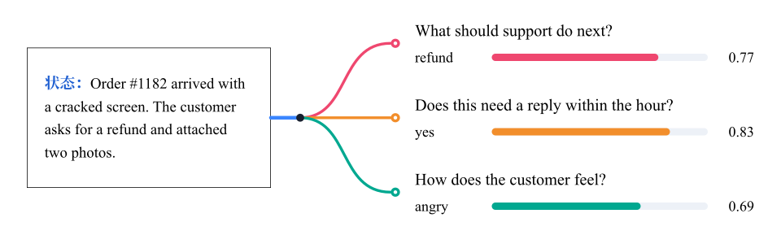
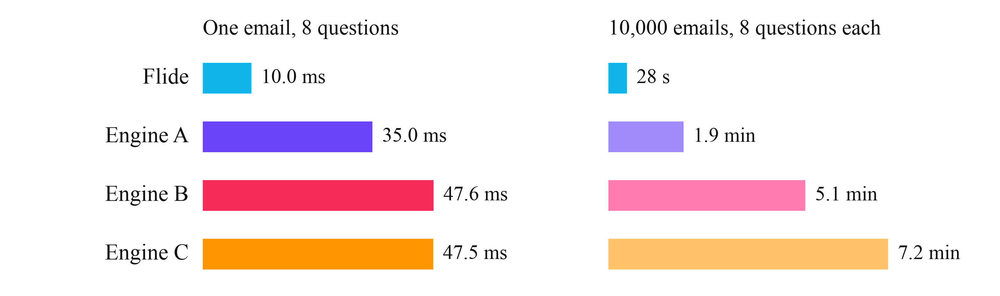

<p align="center">
  
</p>

<p align="center"><a href="../README.md">English</a> · <b>简体中文</b> · <a href="README_ja.md">日本語</a></p>

<p align="center">
  <a href="https://arxiv.org/abs/2610.42148"></a>
  <a href="https://pypi.org/project/flide/"></a>
  <a href="https://flide.org"></a>
  <a href="https://docs.flide.org"></a>
  <a href="../LICENSE"></a>
  <a href="https://www.python.org"></a>
  <a href="https://pytorch.org"></a>
</p>

<p align="center"><a href="#-动态">动态</a> · <a href="#快速开始">快速开始</a> · <a href="#模型">模型</a> · <a href="#选项">选项</a></p>

[Flide](https://docs.flide.org) 是面向 Jev 类决策模型的高速推理基础设施。凭借精确状态分叉，它比 vLLM 和 SGLang 最高快 9.5 倍，每个答案都和模型单独回答这道题时完全一致。接口是 Jev 的 `/v1/systemone`。

<p align="center">
  
</p>

<p align="center">
  
</p>


## 🔥 动态

- 🔥 **2026-11-10** Flide 0.1.11 新增[邮件分拣示例](https://github.com/OmniJev/Flide/tree/main/demos/email_triage)，在一张 H200 上 28 秒给 1 万封邮件各回答 8 个问题。
- 🔥 **2026-11-09** Flide 0.1.10 支持 [Ainvest-Decision](https://huggingface.co/Ainvest-World/Ainvest-Decision-27b-v1.0)、[Darwin-27B-RSI-Decision](https://huggingface.co/FINAL-Bench/Darwin-27B-RSI-Decision) 和 [KnowLine-31B-Gen1.5](https://huggingface.co/PelaAI/KnowLine-31B-Gen1.5)，KnowLine 系列也能读图片了。
- 🔥 **2026-11-09** Flide 0.1.9 支持 [pplx-decider-v1.1-27b](https://huggingface.co/perplexity-ai/pplx-decider-v1.1-27b) 和 [JEV-35B](https://huggingface.co/autotrust/JEV-35B)，`/v1/systemone` 也能在一个请求体里接收多个请求。

<details><summary>更早的动态</summary>

- 🔥 **2026-11-08** Flide 0.1.8 新增两个决策模型家族，包括 [AutoTrust](https://huggingface.co/collections/autotrust/autotrust-decision-models-6ada7050d1462de6733b7f98) 和 [Clef](https://huggingface.co/collections/Cloudflare/clef-6ac429cac15d70ee2af5d1c6)，并支持 [drex-max-v1](https://huggingface.co/nace-ai/drex-max-v1)。
- 🔥 **2026-11-02** 我们的论文 [Flide: Accelerating Decision Inference with Exact State Forking](https://arxiv.org/abs/2610.42148) 已发布到 arXiv。
- 🔥 **2026-10-29** Flide 0.1.7 新增三个决策模型家族，包括 [SynACK Decide](https://huggingface.co/SkyPanther/synack-decide-26b-a4b)、[Wald](https://huggingface.co/collections/org2ai/wald) 和 [Xor](https://huggingface.co/juspay/Xor-26B-A4B)，并支持 Gemma 4 混合专家模型，比如 [KnowLine-26B-A4B](https://huggingface.co/PelaAI/KnowLine-26B-A4B-Gen2.5)。
- 🔥 **2026-10-29** Flide 0.1.6 新增两个决策模型家族，包括 [Drex](https://huggingface.co/nace-ai/drex-v2.0) 和 [KnowLine](https://huggingface.co/PelaAI/KnowLine-35B-A3B-Gen1.5)，新的 `flide verify` 可以在你自己的模型和请求上检查精确分叉。
- 🔥 **2026-10-28** Flide 0.1.5 新增六个决策模型家族，包括 [Jeffan](https://huggingface.co/collections/tattrongvu/decision-model-6ad5c85a79bd246cc1c18c4a)、[JevAny](https://huggingface.co/collections/SimpleJev/jevany-adaptive-decision-systems-6abc8fd39266b1c17b11b4e6)、[Kev](https://huggingface.co/collections/jaredpalmer/kev-6aad9d0ea49f2589665e07cd)、[Lychee](https://huggingface.co/LycheeAI/Lychee-27B)、[pplx-decider](https://huggingface.co/perplexity-ai/pplx-decider-flash-v1.2) 和 [StartLux](https://huggingface.co/collections/startlux-models/startlux-decision-v11-instant-6aca8158623e8e001724cc82)，[Lumma](https://huggingface.co/collections/FrontiersMind/lumma-decision-models-6ab6356434b3db6856ec7ae6) 和 [mammoth](https://huggingface.co/baselabs/mammoth-1) 也能读图片了。
- 🔥 **2026-10-26** Flide 0.1.4 新增五个决策模型家族，包括 [cerno](https://huggingface.co/apertixai/cerno-27b)、[JADE](https://huggingface.co/theunnecessarythings/JADE)、[Linne](https://huggingface.co/collections/PNPM244/decision-model-6ad363fb3351cecf1112a5a8)、[mammoth](https://huggingface.co/baselabs/mammoth-1) 和 [Sieve](https://huggingface.co/collections/sthanika-ai/sieve-6abb93a61dd495f69811c586)，并支持 [Quyet-1.0-Large](https://huggingface.co/chinhnc/Quyet-1.0-Large)。
- 🔥 **2026-10-26** Flide 0.1.3 新增八个决策模型家族，包括 [AJev](https://huggingface.co/andyzhang232/ajev-gemma4-12b-lora7)、[Bespoke-Nimble](https://huggingface.co/bespokelabs/Bespoke-Nimble-9B-v3)、[Darwin](https://huggingface.co/collections/FINAL-Bench/ztc-models-jev-ecosystems-6aafa630afd69b39ead55aa8)、[jiwo](https://huggingface.co/eljiwo/jiwo-4b)、[Lumma](https://huggingface.co/collections/FrontiersMind/lumma-decision-models-6ab6356434b3db6856ec7ae6)、[mogan](https://huggingface.co/moganai/mogan-decision-31B-it)、[Quyet](https://huggingface.co/collections/chinhnc/quyet-10-6ac1b597a9a6a6806bb01fa6) 和 [Senova](https://huggingface.co/WangSenQWQ/Senova-4B)，LoRA 适配器也能直接服务。
- 🔥 **2026-10-25** Flide 0.1.2 新增两个决策模型家族，包括 [Intern-Decision](https://huggingface.co/collections/internlm/intern-decision-6ab75776af19ca84df0bc004) 和 [torchcast](https://huggingface.co/torchcast-ai/torchcast-decision-27b)，每道题最多支持 256 个选项。
- 🔥 **2026-10-24** Flide 0.1.0 已发布到 [PyPI](https://pypi.org/project/flide/)，支持 [Qwen3.5](https://huggingface.co/collections/Qwen/qwen35-6992e3053c019221cf2d725f) 和 [Gemma 4](https://huggingface.co/collections/google/gemma-4-69ce8ad93186d46744cb42f1) 对话模型，以及 [OneJev](https://huggingface.co/collections/OmniJev/onejev16-6ad27669cb868abe0516486d) 和 [Open-Jev](https://huggingface.co/collections/ZefanCai/open-jev-6ab049b9d43a267bae4dedc8) 决策模型，欢迎试用。

</details>

## 快速开始

每个模型的用法、图片、接口和全部选项见[文档](https://docs.flide.org)。

```bash
uv venv -p 3.12 && source .venv/bin/activate
uv pip install flide torchvision
flide serve --model OmniJev/OneJev1.6-0.8B
```

[模型表](#模型)里的任何模型都这样启动，比如 Perplexity 的决策模型。

```bash
flide serve --model perplexity-ai/pplx-decider-flash-v1.2
```

它们都能回答这个请求。

```bash
curl http://localhost:8000/v1/systemone -H "Content-Type: application/json" -d '{
  "state": "Order #1182 arrived with a cracked screen. The customer asks for a refund and attached two photos.",
  "questions": {
    "action": {"type": "choice", "instructions": "What should support do next?",
               "criteria": {"refund": "refund the order", "replace": "send a replacement", "escalate": "ask a human"}},
    "urgent": {"type": "noul", "instructions": "Does this need a reply within the hour?"}
  }
}'
```

## 示例

Flide 给 1 万封邮件各回答 8 个问题，只花费28s。[邮件分拣示例](https://github.com/OmniJev/Flide/tree/main/demos/email_triage)里有自己复现的代码。

<p align="center">
  
</p>

<p align="center">
  
</p>

在一张 H200 上用 OneJev1.6-0.8B，Flide 回答一封邮件要 10.0 毫秒，1 万封要 28 秒，比其他引擎里最快的分别快 3.5 倍和 4.1 倍。

## 模型

后三列是 Flide 回答单个请求比该模型发布版自带的引擎快多少倍，取每个数据集上请求的中位延迟，在一张 H200 上测，DI 指 Decision Index。聊天模型对比的是 vLLM 和 SGLang 中更快的那个，OneJev 对比的是它换用 Flide 之前的 qev，KnowLine 35B 和它的发布版一样用 FP8 跑（`--quantize fp8`），带 ~ 的是测过的几个尺寸的平均值。

| 模型 | 输入 | DI | MultiRC | QuALITY |
|---|---|---:|---:|---:|
| [Ainvest-Decision](https://huggingface.co/Ainvest-World/Ainvest-Decision-27b-v1.0) | 文本 | 1.4× | 1.3× | 1.3× |
| [AJev](https://huggingface.co/andyzhang232/ajev-gemma4-12b-lora7) | 文本 | 3.7× | 9.3× | 2.6× |
| [AutoTrust](https://huggingface.co/collections/autotrust/autotrust-decision-models-6ada7050d1462de6733b7f98) | 文本、图片 | ~3.2× | ~7.6× | ~1.6× |
| [Bespoke-Nimble](https://huggingface.co/bespokelabs/Bespoke-Nimble-9B-v3) | 文本 | 2.6× | 2.1× | 1.6× |
| [cerno](https://huggingface.co/apertixai/cerno-27b) | 文本 | ~4.1× | ~8.6× | 1.1× |
| [Clef](https://huggingface.co/collections/Cloudflare/clef-6ac429cac15d70ee2af5d1c6) | 文本、图片 | 1.3× | 1.0× | 1.0× |
| [Darwin](https://huggingface.co/collections/FINAL-Bench/ztc-models-jev-ecosystems-6aafa630afd69b39ead55aa8) | 文本 | ~1.4× | ~4.2× | ~1.2× |
| [Drex](https://huggingface.co/nace-ai/drex-v2.0) | 文本、图片 | ~2.8× | ~6.2× | ~1.5× |
| [Gemma 4](https://huggingface.co/collections/google/gemma-4-69ce8ad93186d46744cb42f1) | 文本、图片 | ~1.3× | ~1.7× | ~1.0× |
| [Intern-Decision](https://huggingface.co/collections/internlm/intern-decision-6ab75776af19ca84df0bc004) | 文本、图片 | 4.4× | 1.1× | 1.5× |
| [JADE](https://huggingface.co/theunnecessarythings/JADE) | 文本 | 2.0× | 9.2× | 1.7× |
| [Jeffan](https://huggingface.co/collections/tattrongvu/decision-model-6ad5c85a79bd246cc1c18c4a) | 文本 | 3.1× | 2.6× | 1.9× |
| [JevAny](https://huggingface.co/collections/SimpleJev/jevany-adaptive-decision-systems-6abc8fd39266b1c17b11b4e6) | 文本、图片 | 1.5× | 5.8× | 1.2× |
| [jiwo](https://huggingface.co/eljiwo/jiwo-4b) | 文本 | ~1.9× | ~5.9× | 1.8× |
| [Kev](https://huggingface.co/collections/jaredpalmer/kev-6aad9d0ea49f2589665e07cd) | 文本 | ~7.9× | ~1.5× | ~1.7× |
| [KnowLine](https://huggingface.co/PelaAI/KnowLine-35B-A3B-Gen1.5) | 文本、图片 | ~1.4× | ~4.3× | ~1.5× |
| [Linne](https://huggingface.co/collections/PNPM244/decision-model-6ad363fb3351cecf1112a5a8) | 文本 | 2.3× | 8.6× | 1.2× |
| [Lumma](https://huggingface.co/collections/FrontiersMind/lumma-decision-models-6ab6356434b3db6856ec7ae6) | 文本、图片 | 1.7× | 7.1× | 1.2× |
| [Lychee](https://huggingface.co/LycheeAI/Lychee-27B) | 文本 | 1.4× | 1.5× | 1.4× |
| [mammoth](https://huggingface.co/baselabs/mammoth-1) | 文本、图片 | ~4.3× | ~2.8× | ~1.8× |
| [mogan](https://huggingface.co/moganai/mogan-decision-31B-it) | 文本 | 1.6× | 8.5× | 1.8× |
| [OneJev](https://huggingface.co/collections/OmniJev/onejev16-6ad27669cb868abe0516486d) | 文本、图片、视频 | ~6.8× | 7.3× | 4.7× |
| [Open-Jev](https://huggingface.co/collections/ZefanCai/open-jev-6ab049b9d43a267bae4dedc8) | 文本 | 4.2× | 5.0× | ~1.5× |
| [pplx-decider](https://huggingface.co/perplexity-ai/pplx-decider-flash-v1.2) | 文本、图片 | ~2.2× | ~1.4× | ~1.3× |
| [Quyet](https://huggingface.co/collections/chinhnc/quyet-10-6ac1b597a9a6a6806bb01fa6) | 文本 | ~3.9× | ~7.1× | ~1.6× |
| [Qwen3.5](https://huggingface.co/collections/Qwen/qwen35-6992e3053c019221cf2d725f) | 文本、图片 | ~2.1× | ~4.8× | ~1.3× |
| [Senova](https://huggingface.co/WangSenQWQ/Senova-4B) | 文本 | 3.1× | 28.1× | 1.2× |
| [Sieve](https://huggingface.co/collections/sthanika-ai/sieve-6abb93a61dd495f69811c586) | 文本 | 3.0× | 14.3× | 2.6× |
| [StartLux](https://huggingface.co/collections/startlux-models/startlux-decision-v11-instant-6aca8158623e8e001724cc82) | 文本 | 2.6× | 1.1× | 1.2× |
| [SynACK Decide](https://huggingface.co/SkyPanther/synack-decide-26b-a4b) | 文本 | 3.3× | 11.9× | 3.0× |
| [torchcast](https://huggingface.co/torchcast-ai/torchcast-decision-27b) | 文本、图片 | 1.6× | 8.4× | 1.4× |
| [Wald](https://huggingface.co/collections/org2ai/wald) | 文本 | 1.6× | 12.7× | 1.5× |
| [Xor](https://huggingface.co/juspay/Xor-26B-A4B) | 文本、图片、视频 | 2.5× | 6.2× | 2.8× |

## 选项

| 选项 | 作用 |
|---|---|
| `--session-cache-gb 40` | 保存之前请求的状态，智能体的下一步只读新增的部分 |
| `--batch-invariant` | 无论和哪些请求同批，同一个请求的结果逐位相同，速度略慢 |
| `--quantize fp8` | 在 Ada、Hopper、Blackwell 显卡上以 FP8 运行 Qwen3.5 |
| `--frontends 2` | HTTP、渲染和分词放到两个独立进程里，适合大量客户端 |

## 许可证

Apache-2.0。`flide/kernels/gdn.py` 中有一个内核改写自 [flash-linear-attention](https://github.com/fla-org/flash-linear-attention)（MIT）的两个内核，THIRD_PARTY_NOTICES 列出了它和 Flide 用到的其他代码。

## 引用

如果 Flide 对你的研究有帮助，请引用我们的[论文](https://arxiv.org/abs/2610.42148)。

```bibtex
@article{li2026flide,
  title   = {Flide: Accelerating Decision Inference with Exact State Forking},
  author  = {Li, Bobo and Song, Jiajia and Fei, Hao and Hsu, Wynne and Lee, Mong Li},
  journal = {arXiv preprint arXiv:2610.42148},
  year    = {2026}
}
```
