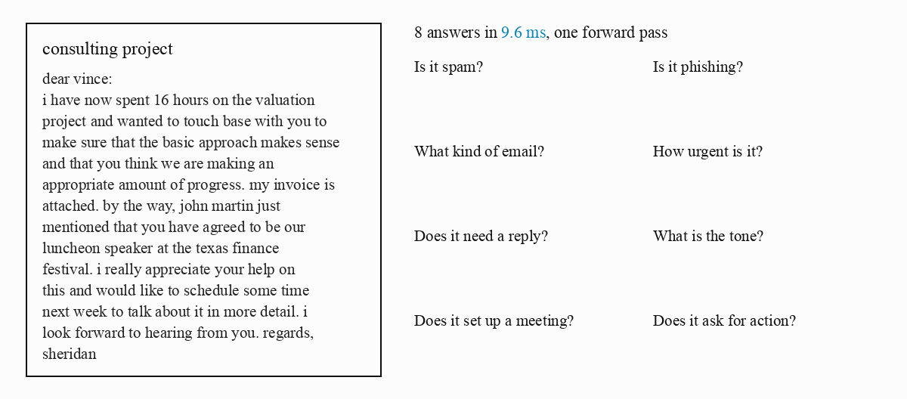
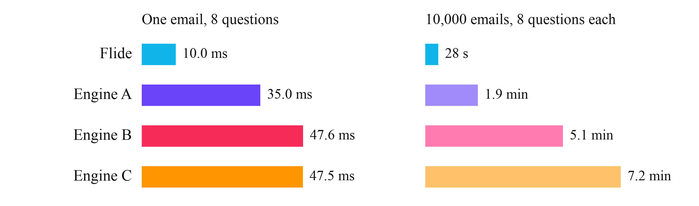

# Email triage

Flide tags an inbox in one pass per email. Each email goes out with eight questions in one request, and Flide reads
the email once for all eight.

<p align="center">
  
</p>

## Run it

```bash
uv venv -p 3.12 && source .venv/bin/activate
uv pip install flide torchvision
python make_requests.py
flide run --model OmniJev/OneJev1.6-0.8B --rows requests.jsonl --out answers
```

`make_requests.py` takes 10,000 emails from the [Enron-Spam](https://huggingface.co/datasets/SetFit/enron_spam) corpus,
half spam and half not, and gives each one the questions in `questions.json`. Edit that file to ask your own questions.
`answers/results.jsonl` then holds the eight answers of every email, next to the corpus label.

To time a server, start it and send the emails from 64 clients.

```bash
flide serve --model OmniJev/OneJev1.6-0.8B
python bench.py --url http://localhost:8000 --rows requests.jsonl --clients 64
```

`bench.py` works with any server that speaks the `/v1/systemone` API, so the same command times other engines too.

## Results

<p align="center">
  
</p>

One H200 and OneJev1.6-0.8B in bfloat16 for every engine. The left panel is the median time of one email sent alone,
the right panel the time for all 10,000 emails from 64 clients. Flide reads OneJev's own prompt, which is longer than
the prompts Engines A and B build for the same model.

The corpus comes lowercased and with spaces around punctuation, as its makers prepared it.
